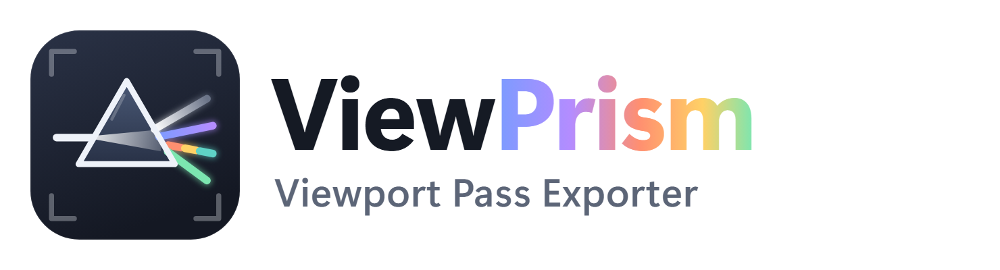
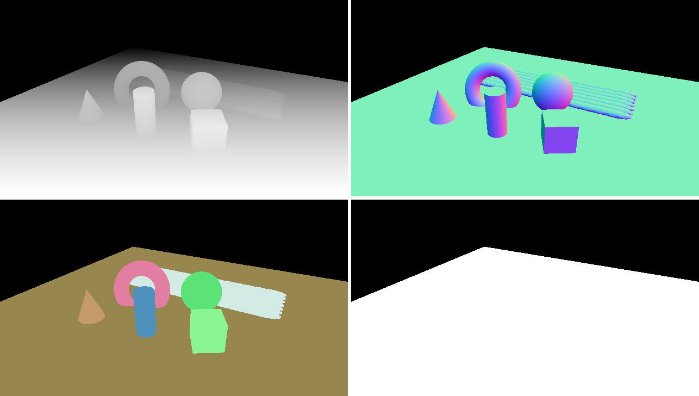
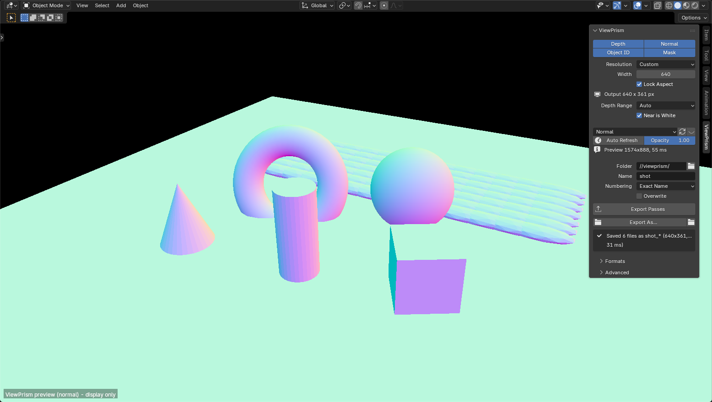

<p align="center">
  <picture>
    <source media="(prefers-color-scheme: dark)" srcset="branding/viewprism-wordmark-dark.png">
    
  </picture>
</p>

<p align="center">
  <a href="https://github.com/marc2825/ViewPrism/actions/workflows/ci.yml"></a>
  <a href="https://github.com/marc2825/ViewPrism/releases"></a>
  
  <a href="LICENSE"></a>
  
</p>

# ViewPrism — Viewport Pass Exporter

[English](README.md)

いま見ている3Dビューポートから、画素単位で揃った **Depth / Normal / Object ID / Mask** をワンクリックで書き出す Blender アドオンです。カメラもコンポジタもレンダー設定も不要で、シーンは一切変更しません。



*`tools/make_screenshots.py` による実際の出力です。深度（手前が白）、カメラ空間法線、オブジェクトID（表示用に着色。ファイルには整数IDを保存）、マスク。*

> **状態: プレリリース。** 検証済み環境は Blender 5.3.0 / Windows 11 / NVIDIA（Vulkan・OpenGL）と、CI 上の Linux（Mesa のソフトウェア OpenGL）での Blender **4.5.17 LTS** / 5.3.0 です。
> macOS（Metal）、AMD・Intel GPU、Windows 上の 4.5、Blender 5.0〜5.2 は未検証です。Blender 4.5 以上が必要です。ライセンスは未決定です（末尾参照）。

## 特長

Blender 標準のパスは正確ですが、カメラ、ビューレイヤーのパス、コンポジタまたは出力設定、レンダリングが必要で、その変更はファイルに残ります。ViewPrism は現在のビューの評価済みジオメトリを GPU で一度だけ描画し、データパスを直接書き出します。

- **現在の視点から、カメラ不要。** 透視・平行投影・カメラビューに対応。カメラビューではレンダーと同じカメラ枠をそのまま書き出します。
- **シーンを変更しない。** オブジェクト、カメラ、マテリアル、ノード、パス、レンダー設定を作成・変更せず、アンドゥ履歴も増やしません。設定は .blend に保存されません。
- **パス間の整合性。** 深度・法線・ID・マスクは同じ描画の同じフラグメントから得るため、構造的に一致します（`マスク == 深度が有限 == ID > 0`）。
- **データとして使える値。** シーン単位の平面深度（float EXR）、符号付きカメラ空間法線、どのレンダーエンジンでも使える整数オブジェクトID、行列とID対応表を含む JSON。

## インストール

1. [Releases](https://github.com/marc2825/ViewPrism/releases) から `viewprism-<version>.zip` をダウンロード（プレリリースはその旨を表示。`.sha256` ファイルも添付）。ソースからビルドする場合:
   `python tools/build_extension.py --blender "<path>/blender.exe"` → `dist/viewprism-<version>.zip`
2. Blender ›「編集」›「プリファレンス」›「エクステンションを入手」› ⌄ ›「ディスクからインストール…」でZIPを選択。
3. 3Dビューポート › サイドバー（N）› **ViewPrism** タブ。

## 使い方



1. 書き出すパス（**Depth / Normal / Object ID / Mask**）を選択。
2. 解像度: **View**（ビューポートサイズ×倍率。カメラビューではレンダー解像度）または **Custom**（縦横比ロック、またはロック解除で中央トリミング）。
3. 任意: パスを選び更新アイコンで表示専用の**プレビュー**をビューポートに重ねて表示。**Auto Refresh** で視点やシーンの変更後に自動更新。
4. **Export Passes** で出力フォルダ（既定は保存済み .blend の隣の `//viewprism/`）へ連番付きで保存。**Export As…** ではフォルダと名前を指定できます（視点はファイルブラウザを開いた時点で確定）。

## 出力

| ファイル | 内容 | 形式 |
|---|---|---|
| `<name>_depth.exr` | 平面深度: 視線方向の距離（ビュー空間の −Z）、シーン単位 | float32 `Z`（背景は NaN）+ `A` マスク |
| `<name>_depth.png` | 表示用深度: near〜far で線形（Auto = 見えている最も近い面〜最も遠い面、または Fixed） | 8/16bit グレー。既定は手前が白、背景は遠方色（変更可） |
| `<name>_normal.png` | カメラ空間法線: +X 右、+Y 上、+Z 手前 | RGB = n × 0.5 + 0.5、8/16bit、X/Y 反転オプション、背景は黒または (0.5, 0.5, 1) |
| `<name>_normal.exr` | 符号付き法線 | float32 `R G B` + `A` マスク |
| `<name>_id.png` | オブジェクトID（0 = 背景） | 16bit グレー、画素値 = ID（最大 65 535） |
| `<name>_id.exr` | オブジェクトID | 32bit 符号なし整数チャンネル `id` |
| `<name>_mask.png` | 前景マスク | 8bit、255 = 前景 |
| `<name>_meta.json` | ビュー/投影行列、解像度、フレーム、深度範囲と向き、ID→オブジェクト名、警告、処理時間 | JSON（絶対パスは含めません） |

規約: 画素は上の行から、各画素中心で1サンプル（アンチエイリアスなし）、色管理なし。IDはキャプチャごとにオブジェクト名順で割り当て（既定は元オブジェクト単位。インスタンサー単位・インスタンス単位も選択可）。

自由視点の平行投影では、すべての深度が正になるよう深度の原点を手前のクリップ面へ移動します（メタデータに記録）。カメラビューではレンダーの Depth パスと同じくカメラからの距離です。同じカメラの Cycles と比較した誤差は、深度の相対誤差 p99 が 4e-6、法線が 0.02° でした。

## 制限事項

- ジオメトリのみ: シェーダーのディスプレイスメント、バンプ/ノーマルマップ、アルファ透過、ボリューム、ヘア/カーブ、ポイントクラウド、グリースペンシルは反映されません。ディスプレイスメント、透過、ビューポートとレンダーでモディファイア設定が異なるオブジェクトは警告し、未対応の可視オブジェクトは一覧表示します。
- ワイヤー/バウンディング表示のオブジェクトは除外。ビューポートのクリッピング領域（Alt+B）は適用されません。
- エッジはエイリアスあり（1画素1サンプル。Cycles のデータパスと同様）。
- アニメーション（連番）出力は未対応。
- 1辺最大 16 384 px、1枚最大 3,350万画素。IDのPNGは最大 65 535（それ以上は EXR）。
- 速度: 1080p のキャプチャは約 50〜200 ms ＋ファイル書き出しです。設定済みの EEVEE パスレンダーと同程度で、利点は速度ではなく「準備不要でシーンを変えないこと」です（[docs/PERFORMANCE.md](docs/PERFORMANCE.md)）。

## 他の方法との比較

カメラとコンポジタを既に用意しているなら、Blender 標準のパスが基準です（シェーディング効果も反映されます）。AI向けアドオンの多くはカメラとコンポジタでレンダリングし、コンポジタ設定を書き換えたり消したりするものもあります。ViewPrism が優れていない点も含めた比較は [docs/COMPETITORS.md](docs/COMPETITORS.md) を参照してください。

## 開発

```
# 純粋テスト（Blender UI 不要。Blender 同梱の NumPy 入り Python を使用）
"<blender dir>/5.3/python/bin/python.exe" -m unittest discover -s tests/pure
# 全検証: 独立ハーネス、GPUバックエンド別GUIスイート、ビルド、パッケージ導入/削除（--bench で性能比較）
python tools/run_all_checks.py --blender "<path>/blender.exe"
```

CI（GitHub Actions）では、lint、Windows/Linux での純粋テスト、Linux 上の Blender 4.5 LTS と 5.3（Xvfb + Mesa ソフトウェア OpenGL）による全検証を実行します。`vX.Y.Z` タグを push すると、検証済みZIPを添付した下書きリリースを作成します。

- `viewprism/` — アドオン本体（`projection`、`encode`、`png`、`exr`、`export`、`writer` は `bpy` を使いません）。UI もテストも同じ入口 `viewprism.capture.capture(context, request)` を通ります。
- `viewpass-dev/` — 独立検証ハーネスと仕様書（変更していません）。
- 設計: [docs/decisions/0001-renderer.md](docs/decisions/0001-renderer.md) · 状況: [docs/STATUS.md](docs/STATUS.md) · テスト: [docs/TEST_MATRIX.md](docs/TEST_MATRIX.md) · [CONTRIBUTING.md](CONTRIBUTING.md)

## ライセンス

**GNU General Public License バージョン3、またはそれ以降の任意のバージョン**（`GPL-3.0-or-later`）で提供します。詳細は [LICENSE](LICENSE) を参照してください。Copyright © 2026 marc2825.

`branding/` のロゴと `docs/images/` の画像にも同じライセンスが適用されます。ただし、ViewPrism の名称やロゴを他の製品の商標として使う権利は含みません。
