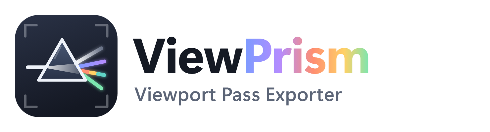
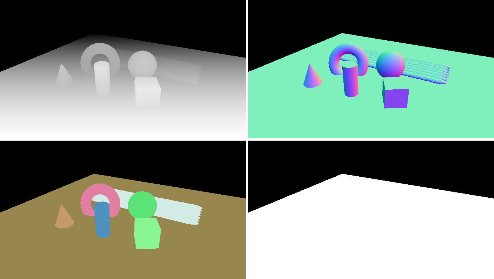
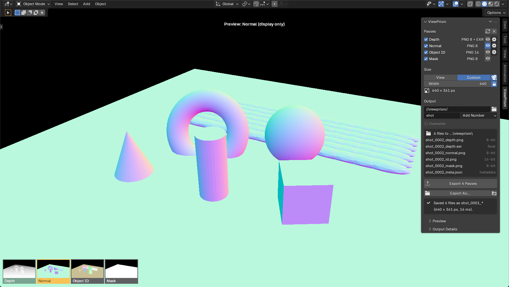

<p align="center">
  <picture>
    <source media="(prefers-color-scheme: dark)" srcset="branding/viewprism-wordmark-dark.png">
    
  </picture>
</p>

<p align="center">
  <a href="https://github.com/marc2825/ViewPrism/actions/workflows/ci.yml"></a>
  <a href="https://github.com/marc2825/ViewPrism/releases"></a>
  
  
</p>

# ViewPrism — Viewport Pass Exporter

[日本語](README.ja.md)

Export pixel-aligned **Depth**, **Normal**, **Object ID** and **Mask** images from the 3D viewport you
are looking at, in one click. No camera, no compositor, no render settings, and nothing in your scene
changes.



*Real output from `tools/make_screenshots.py`: depth (near = white), camera-space normal, object ID
(shown with display colours; the file stores the integer ID), mask.*

> **Status: pre-release.** Verified on Blender 5.3.0 / Windows 11 / NVIDIA (Vulkan and OpenGL), and
> in CI on Linux with Blender **4.5.17 LTS** and 5.3.0 (Mesa software OpenGL). Not verified yet:
> macOS/Metal, AMD/Intel GPUs, Blender 4.5 on Windows, Blender 5.0–5.2. Requires Blender 4.5 or newer.
> License not decided yet (see below).

## Why

Blender's own passes are accurate but need a camera, view-layer passes, compositor or output setup and
a render, and they leave those changes in your file. ViewPrism draws the evaluated geometry of the
current view once on the GPU and writes the data passes directly:

- **Current view, no camera.** Perspective, orthographic and camera views; when you look through a
  camera, the exact camera frame is exported (same framing as a render).
- **Nothing changes.** No objects, cameras, materials, nodes, passes or render settings are created or
  modified, no undo steps; settings are not saved into your .blend file.
- **Consistent passes.** Depth, normal, ID and mask come from the same fragment of one draw, so they
  are aligned by construction (`mask == finite depth == id > 0`).
- **Real data.** Planar depth in scene units as float EXR, signed camera-space normals, integer object IDs with
  any render engine, and a JSON file with matrices and the ID map.

## Install

1. Download `viewprism-<version>.zip` from [Releases](https://github.com/marc2825/ViewPrism/releases)
   (pre-releases are marked as such; a `.sha256` file is attached). Alternatively build it from source:
   `python tools/build_extension.py --blender "<path>/blender.exe"` → `dist/viewprism-<version>.zip`
2. Blender › Edit › Preferences › Get Extensions › ⌄ › **Install from Disk…** › choose the ZIP.
3. 3D Viewport › Sidebar (N) › **ViewPrism** tab.

## Use



1. Toggle the passes: **Depth**, **Normal**, **Object ID**, **Mask**.
2. Resolution: **View** (viewport size × scale, or the render size in camera view) or **Custom**
   (width with locked aspect, or width × height as a centred crop).
3. Optional: pick a pass and press the refresh icon for a display-only **preview** over the viewport;
   **Auto Refresh** re-captures shortly after the view or scene changes.
4. **Export Passes** writes to the folder (default `//viewprism/` next to the saved .blend) with
   automatic numbering. **Export As…** chooses folder and name; the view is captured when you open the
   file browser.

## Output

| File | Content | Encoding |
|---|---|---|
| `<name>_depth.exr` | planar depth: distance along the view direction (−Z in view space), scene units | float32 `Z` (NaN = background) + `A` mask |
| `<name>_depth.png` | display depth: linear between near/far (Auto = nearest…farthest visible surface, or Fixed) | 8- or 16-bit gray; near = white by default; background = far colour (configurable) |
| `<name>_normal.png` | camera-space normal: +X right, +Y up, +Z towards the viewer | RGB = n × 0.5 + 0.5, 8/16-bit, optional Flip X/Y; background black or (0.5, 0.5, 1) |
| `<name>_normal.exr` | signed normals | float32 `R G B` + `A` mask |
| `<name>_id.png` | object ID, 0 = background | 16-bit gray, pixel value = ID (max 65 535) |
| `<name>_id.exr` | object ID | 32-bit unsigned integer channel `id` |
| `<name>_mask.png` | foreground mask | 8-bit, 255 = foreground |
| `<name>_meta.json` | view/projection matrices, resolution, frame, depth range and direction, ID → object name map, warnings, timings | JSON (no absolute paths) |

Conventions: pixel rows top to bottom, samples at pixel centres, one sample per pixel (no
anti-aliasing), no colour management. IDs are assigned by sorted object name per capture (per source
object by default; per instancer or per instance optional).

In a free orthographic viewport the depth origin is moved back to the near clipping plane so all depths
are positive (recorded in the metadata). In camera view the depth is measured from the camera like the
render's Depth pass. Measured against Cycles from the same camera: p99 relative depth error 4e-6,
normals 0.02°.

## Limitations

- Geometry only: shader displacement, bump/normal maps, alpha transparency, volumes, hair/curves, point
  clouds and Grease Pencil are not represented. ViewPrism warns about displacement, transparency and
  objects whose viewport and render modifiers differ, and lists unsupported visible objects.
- Objects displayed as Wire/Bounds are skipped. The viewport clipping region (Alt+B) is not applied.
- Aliased edges (single sample per pixel), like Cycles' data passes.
- No animation/sequence export yet.
- Max. 16 384 px per side and 33.5 MP per image; object ID PNG max 65 535 (use EXR above).
- Speed: a 1080p capture takes ~50–200 ms, plus file encoding. That is comparable to a pre-configured
  EEVEE pass render. The point is the missing setup and the untouched scene, not raw speed
  (see [docs/PERFORMANCE.md](docs/PERFORMANCE.md)).

## Alternatives

If you already have a camera and a compositor setup, Blender's own passes are the reference (and also
cover shading effects). Many AI-oriented add-ons render via the camera and compositor, and some
change or wipe compositor setups. See [docs/COMPETITORS.md](docs/COMPETITORS.md) for a sourced
comparison, including where ViewPrism is *not* better.

## Development

```
# pure tests (no Blender UI; uses Blender's bundled Python with NumPy)
"<blender dir>/5.3/python/bin/python.exe" -m unittest discover -s tests/pure
# everything: independent harness, GUI/GPU suite per backend, build, package lifecycle (+ --bench)
python tools/run_all_checks.py --blender "<path>/blender.exe"
```

CI (GitHub Actions) runs lint, the pure tests on Windows/Linux, and the full Blender checks on Linux
for Blender 4.5 LTS and 5.3 (Xvfb + Mesa software OpenGL). A `vX.Y.Z` tag builds the validated ZIP
into a draft release.

- `viewprism/` — the add-on (pure modules `projection`, `encode`, `png`, `exr`, `export`, `writer` do not
  import `bpy`). The UI and the tests use the same entry point: `viewprism.capture.capture(context, request)`.
- `viewpass-dev/` — the independent verification harness and specification (kept unchanged).
- Design: [docs/decisions/0001-renderer.md](docs/decisions/0001-renderer.md) · Status:
  [docs/STATUS.md](docs/STATUS.md) · Tests: [docs/TEST_MATRIX.md](docs/TEST_MATRIX.md) ·
  [CONTRIBUTING.md](CONTRIBUTING.md)

## License

Not decided yet. The candidate is GPL-3.0-or-later (required for add-ons on extensions.blender.org).
Until the owner decides, no license is granted beyond what applies by default. The same applies to the
logo (`branding/`).
